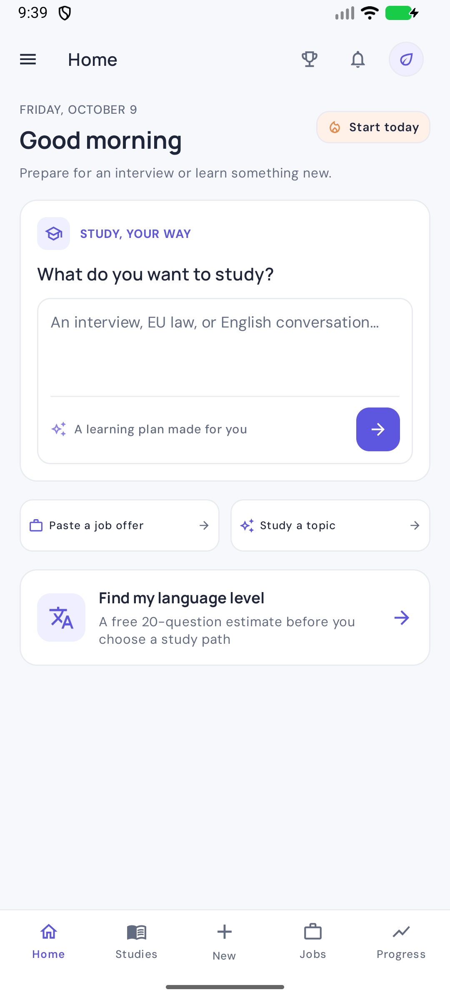
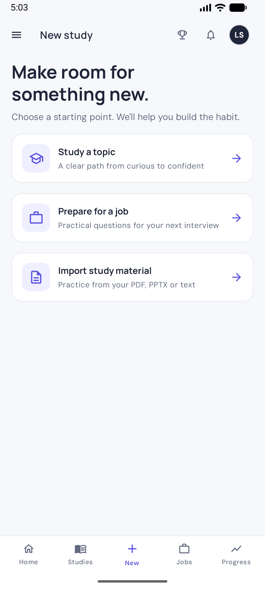
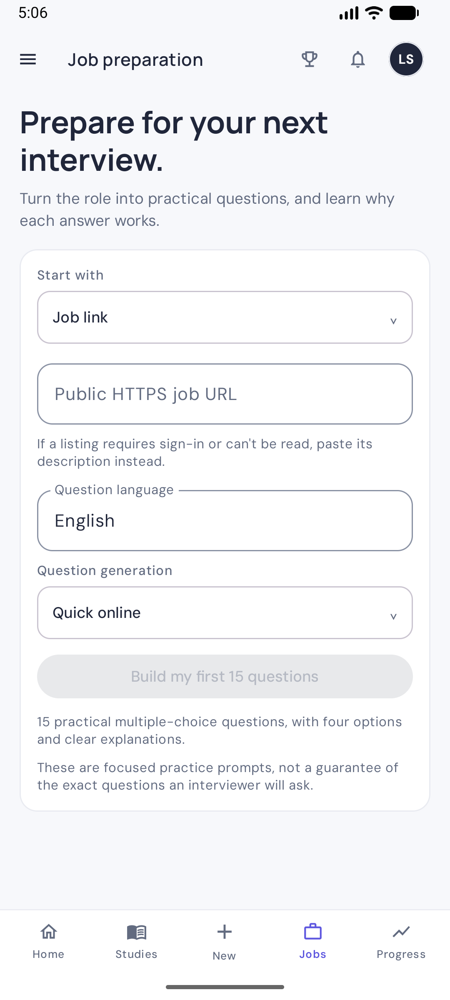
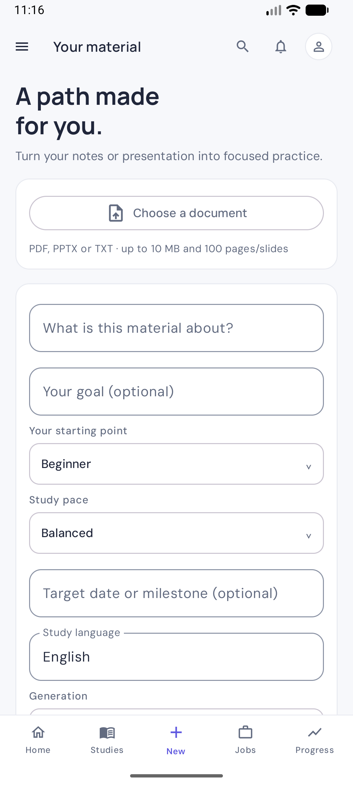
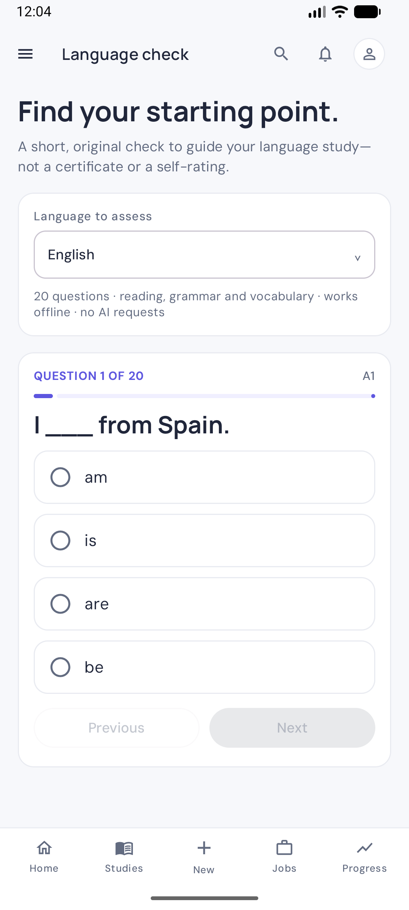
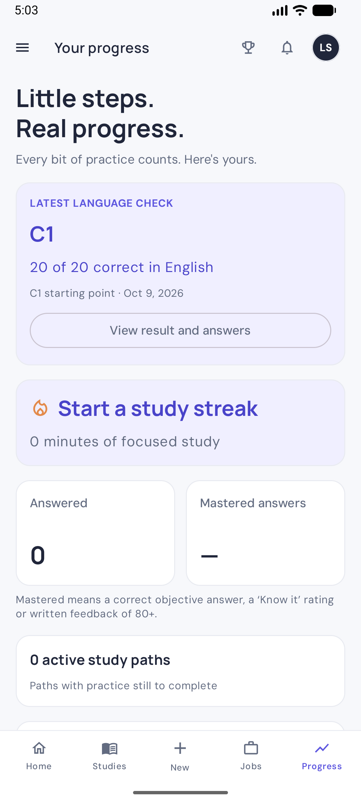

# LetsStudy

<p align="center">
  
</p>

<p align="center"><strong>Learn something new. Feel ready for what’s next.</strong></p>

<p align="center">Explore a topic, build a language skill, study your own materials, or prepare for an interview or meeting. LetsStudy turns your goal into a guided path with focused practice.</p>

<p align="center">Understand each answer, revisit what you have learned, and keep track of your progress.</p>

<p align="center">
  <a href="https://github.com/ovallsn/letsstudy/actions/workflows/android.yml"></a>
  <a href="LICENSE"></a>
  
</p>

LetsStudy is a native Android learning app for people with something specific they want to understand or prepare for. Start with a subject, a job listing, a language goal, or a document. Follow a study path, practise with questions, see why an answer works, and return to your saved progress.

## One app, different reasons to learn

- **Learn a topic.** Choose a subject such as European law, networking, or a new technical skill. LetsStudy creates an ordered path with lessons and practice so a broad goal has a useful next step.
- **Improve a language.** Take an original short written check in English, Spanish, French, or Thai. Use the approximate result to choose a starting point, study with examples and common mistakes, and take a later check to move up a level.
- **Study your own material.** Import a text PDF, PowerPoint presentation, or text file and build practice from the extracted content. Scanned PDFs can use on-device OCR for up to 30 pages of printed Latin text.
- **Prepare for an interview.** Turn a public job listing or pasted description into role-focused multiple-choice practice, mock interviews, and clear explanations. Questions draw on the role and relevant industry context; they are practice, not a promise of what an interviewer will ask.
- **Make learning stick.** Review saved answers, revisit explanations and lessons, ask the study tutor for help, and use spaced review to return to questions at a sensible time.

The language check is a study recommendation based on a short sample of written grammar, vocabulary, and reading. It is not an official CEFR or EF SET score and does not measure speaking, listening, or writing. Its questions are original and do not reproduce another provider’s exam bank.

## A look inside

These are native Android screens with fictional study content and a demo profile. They do not contain a real learner’s account or study history.

<table>
  <tr>
    <th>Start with a goal</th>
    <th>Choose how to study</th>
  </tr>
  <tr>
    <td></td>
    <td></td>
  </tr>
  <tr>
    <th>Prepare for an interview</th>
    <th>Learn from your notes</th>
  </tr>
  <tr>
    <td></td>
    <td></td>
  </tr>
  <tr>
    <th>Find a language starting point</th>
    <th>Keep your progress</th>
  </tr>
  <tr>
    <td></td>
    <td></td>
  </tr>
</table>

## How a study session works

1. Choose a topic, job listing, language, or file, then set the study language and starting point.
2. Build a path or a focused practice round using the generation option selected in the app.
3. Answer questions in formats such as multiple choice, scenarios, vocabulary, flashcards, and code or command prompts. Code is treated as study text; the app does not run it.
4. Read the explanation, move to the next question, or ask for a deeper lesson when you want more context.
5. Find saved sessions, questions, lessons, and progress in your study library. Sign in only if you want to sync your private study data across devices.

## AI choices

The app supports three ways to generate study content:

- **Gemini · Fast online.** Uses Firebase AI Logic. The app owner’s Google project supplies the shared quota, so request limits and service availability can change.
- **ChatGPT · Connect your account.** An optional Sign in with ChatGPT flow can use eligible account access for the app. Each learner connects their own account; a ChatGPT subscription is not unlimited app capacity, and access or usage limits may apply.
- **On-device.** An optional Gemma model runs on the phone after a one-time download. This avoids sending study text to a generation service for that action, but requires substantial storage and can be slower.

The learner chooses the provider in the app. LetsStudy does not silently send a request to another provider when one fails. A usage-limit fallback to the on-device model is available only when the learner enables it. A topic or job can still be studied without connecting a separate AI account; the optional LetsStudy account is only for syncing app data.

Generated material can be incomplete or wrong. Check legal, medical, safety, and technical information against sources you trust before relying on it.

## Privacy and sharing

- Study sessions are stored locally on the phone. Account creation and cross-device sync are optional.
- After a learner chooses sync and accepts the disclosure, private profile and study records are stored under that learner’s Firebase Authentication ID. Firestore rules restrict private records to their owner; an administrator claim alone does not grant access.
- A job URL is read by the app on the phone. The app does not bypass sign-in pages or access controls. For online generation, relevant extracted text and request context go to the selected provider; imported file bytes are not uploaded as the generation request.
- Gemini and ChatGPT requests are sent to their respective providers when selected. The app shows a separate disclosure before first use. On-device generation keeps the prompt on the phone.
- The optional community board is separate from private study sync. Joining shares a chosen nickname and self-reported weekly points with signed-in learners. A profile-photo thumbnail is shared only after a separate opt-in. Email, study topics, answers, and account IDs are not included in the board entry.
- The full profile photo remains in local app storage. The optional board receives only a small resized thumbnail; turning photo sharing off or leaving the board removes that public copy.

## Built for Android

LetsStudy is implemented with **Kotlin and Jetpack Compose**. The main engineering decisions include:

- **Local-first study data:** Room stores sessions, answers, progress, saved lessons, and review schedules; Firebase sync is opt-in and scoped to the signed-in learner.
- **Validated AI output:** generated rounds and lessons are checked before they are saved, so incomplete output does not replace an existing study.
- **Bounded imports and URL reading:** job pages use HTTPS with redirect, address, time, and response-size checks. PDF, PPTX, and text imports have file and content limits.
- **Secure account boundaries:** Firestore rules and emulator tests cover owner-only records, username reservations, and the separate community projection.
- **Learner-controlled provider access:** ChatGPT authorization uses PKCE and a local callback; credentials are protected on the device and are not synced to Firestore.

Architecture and release notes are in [`docs/architecture.md`](docs/architecture.md) and [`docs/release.md`](docs/release.md). Third-party licenses and model notices are listed in [`THIRD_PARTY_NOTICES.md`](THIRD_PARTY_NOTICES.md).

## Build locally

### Requirements

- Android Studio with Android SDK 36
- Java 17
- A Firebase project with an Android app registered as `com.oriol.letsstudy` for online generation and optional account sync

### Setup

1. Enable Firebase AI Logic and configure the Gemini Developer API if you want the Gemini provider.
2. Register the Android package in your Firebase project and place its `google-services.json` at `android/app/google-services.json`. This file is ignored by Git; provide your own Firebase configuration for a local build.
3. Enable Email/Password in Firebase Authentication if you want account sync.
4. Create a Firestore database and publish the access policy from [`firestore.rules`](firestore.rules). Create the composite index in [`firestore.indexes.json`](firestore.indexes.json) for the community board. Choose the database region for your expected learners; Firebase does not let you change it after creation.
5. Configure Firebase App Check. Debug builds use the debug provider; register its token in the Firebase Console and keep the token out of Git. Release builds use Play Integrity and need the correct signing certificate registered.

The app can be used as a guest without enabling account sync. Firebase free allowances and provider quotas are finite; this project does not enable billing automatically.

### Build a debug APK

From the Android project directory:

```powershell
cd android
./gradlew.bat :app:assembleDebug
```

The APK is written to `android/app/build/outputs/apk/debug/app-debug.apk`. For the documented test, lint, and unsigned release tasks, run:

```powershell
./gradlew.bat :app:testDebugUnitTest :app:lintDebug :app:assembleRelease
```

GitHub Actions also runs Android checks and Firestore rules tests in the local Firebase emulator. The release build from CI is unsigned; distributing an APK or publishing to Google Play requires maintainer-controlled signing configuration. See [`docs/release.md`](docs/release.md).

## License

LetsStudy is released under the [MIT License](LICENSE). Third-party libraries, fonts, and model components retain their own terms; see [`THIRD_PARTY_NOTICES.md`](THIRD_PARTY_NOTICES.md).
